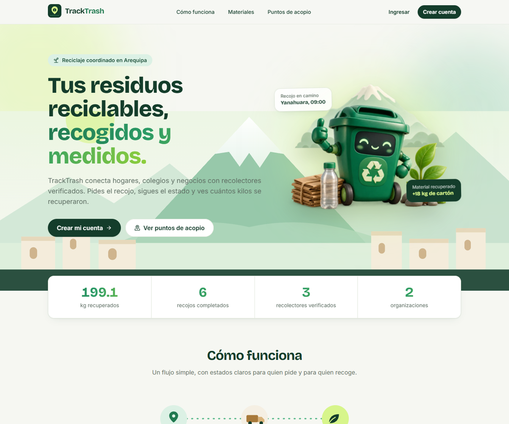
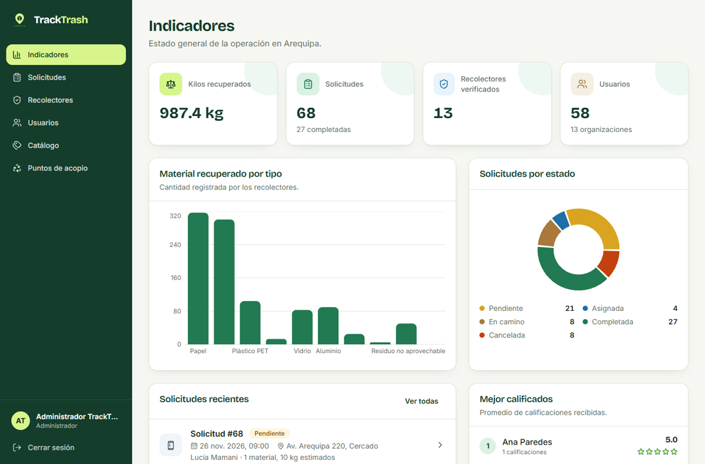
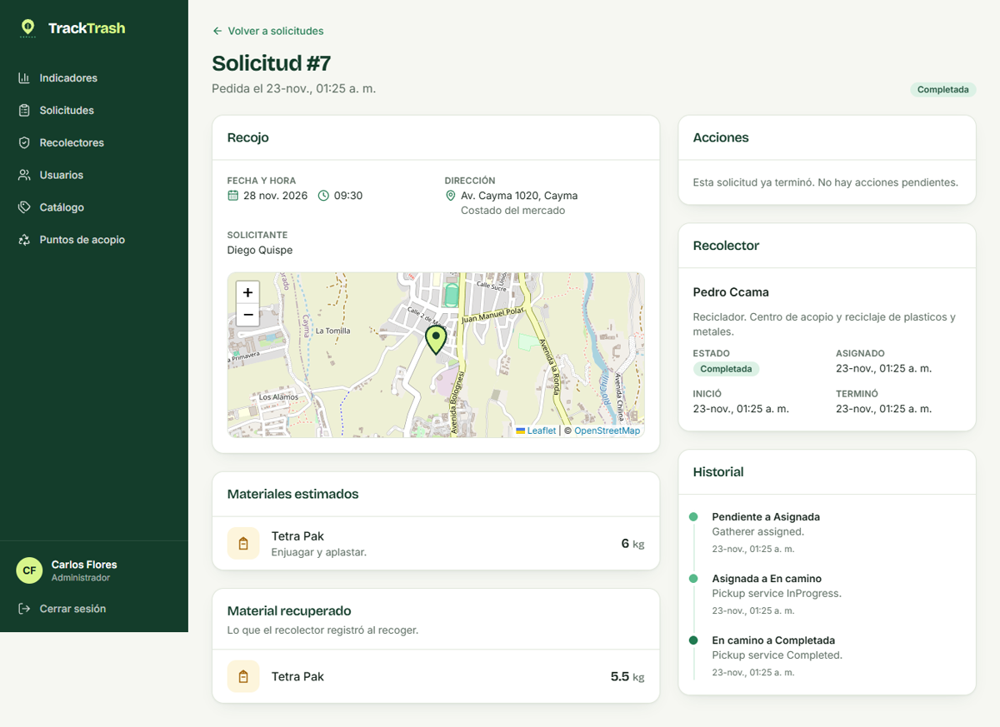
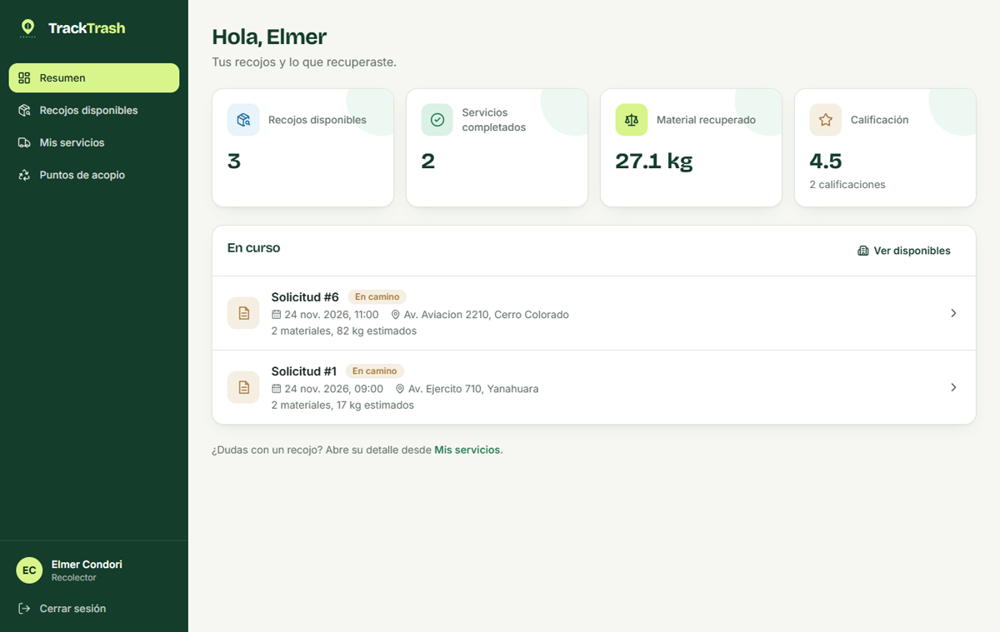
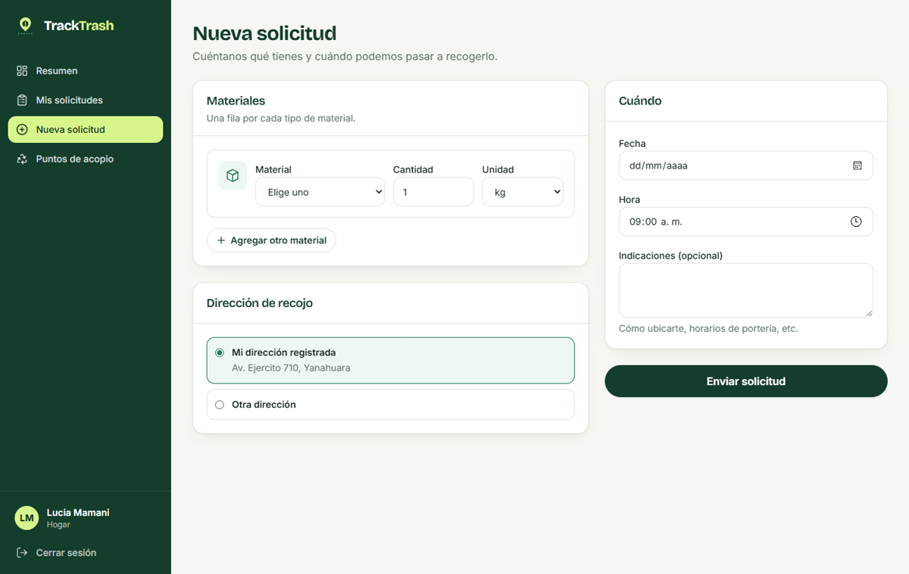
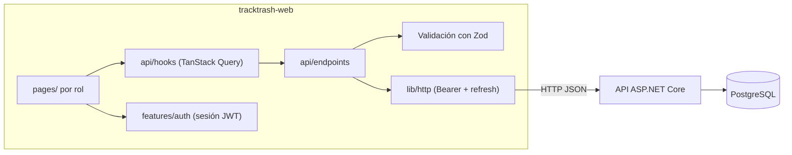

<p align="center">
  
</p>

<p align="center">
  
  
  
  
  
</p>

<p align="center">
  <a href="#funcionalidades">Funcionalidades</a> ·
  <a href="#capturas">Capturas</a> ·
  <a href="#arquitectura">Arquitectura</a> ·
  <a href="#ejecutar-en-local">Ejecutar en local</a> ·
  <a href="#despliegue">Despliegue</a>
</p>

## Sobre el proyecto

**TrackTrash** coordina el recojo de residuos reciclables en Arequipa entre hogares, organizaciones y recolectores
verificados. Esta es la aplicación web: sitio público, panel por rol y administración del catálogo. Consume la API REST
del backend en ASP.NET Core y comparte el contrato con la [app móvil en Flutter](https://github.com/CarlosFloresDev/tracktrash-mobile).

| En línea | URL |
| --- | --- |
| Web | https://tracktrash.pages.dev |
| API | https://tracktrash-backend.onrender.com (estado: [`/api/health`](https://tracktrash-backend.onrender.com/api/health)) |

| Repositorio | Tecnología |
| --- | --- |
| Web (este repositorio) | React, TypeScript, Tailwind CSS |
| [Mobile](https://github.com/CarlosFloresDev/tracktrash-mobile) | Flutter, Riverpod |
| [Backend](https://github.com/Luladusilva/TrackTrash) | ASP.NET Core 10, CQRS con MediatR, PostgreSQL |

## Funcionalidades

| Rol | Qué puede hacer |
| --- | --- |
| Visitante | Landing, catálogo de materiales y mapa de puntos de acopio |
| Hogar y organización | Crear solicitudes con varios materiales y dirección con GPS, ver recolectores compatibles, aceptar o rechazar postulaciones, seguir estados e historial, cancelar y calificar |
| Recolector | Elegir los materiales que acepta, ver recojos compatibles y postularse, iniciar, registrar material recuperado, finalizar o soltar; kilos y calificación propios |
| Administrador | Indicadores con gráficos, todas las solicitudes, asignación directa, verificación de documentos, usuarios y catálogo |
| Todos | Inicio de sesión con JWT: el token se renueva solo mientras hay actividad y se revoca al salir |
| Búsqueda y filtros | Buscador sin distinguir tildes ni mayúsculas, con filtros por estado, material, distrito, rol, verificación y categoría, en solicitudes, recolectores, usuarios, catálogo y puntos de acopio (el mapa se filtra junto con la lista) |

Detalles de experiencia: animaciones al hacer scroll, contadores animados, transiciones entre páginas, estados de carga,
vacío y error en todas las vistas, y soporte para "reducir movimiento" del sistema operativo.

## Capturas

<p align="center">
  
</p>

<table>
  <tr>
    <td></td>
    <td></td>
  </tr>
  <tr>
    <td align="center">Indicadores del administrador</td>
    <td align="center">Detalle de solicitud con mapa e historial</td>
  </tr>
  <tr>
    <td></td>
    <td></td>
  </tr>
  <tr>
    <td align="center">Panel del recolector</td>
    <td align="center">Nueva solicitud</td>
  </tr>
</table>

## Arquitectura



```
src/
  api/          contrato del backend: enums, esquemas Zod, endpoints tipados y hooks
  app/          router con carga diferida por página y proveedores
  components/   brand (logo e ilustraciones SVG), layout, ui (kit propio), map
  features/     auth (login, sesión y renovación de tokens) y requests (listas y cruces de datos)
  lib/          cliente HTTP, formato es-PE, variables de entorno
  pages/        public/ y app/
local-dev/      vistas SQL locales, datos de ejemplo y scripts de base local
docs/           hallazgos del backend y recursos del README
```

Decisiones de diseño:

* **Contrato validado:** cada respuesta pasa por un esquema Zod; si el backend cambia, el error aparece de inmediato.
* **Sesión JWT:** `features/auth` hace login, guarda el par de tokens y `lib/http` agrega el `Bearer`. Un
  `401 ACCESS_TOKEN_EXPIRED` dispara una sola renovación compartida y reintenta; el logout revoca el refresh token.
* **Permisos por rol:** cada vista solo consulta endpoints permitidos para su rol (ver
  [hallazgos del backend](docs/HALLAZGOS_BACKEND.md)).
* **Reglas espejo:** las transiciones de estado replican `CollectRequestStatusRules` para mostrar solo acciones válidas.
* **Rendimiento:** páginas con `lazy`, gráficos y mapa en chunks separados, imágenes en WebP.
* **Fotos con licencia libre:** las fotos de materiales vienen de Wikimedia Commons; autor y licencia se listan en `/creditos`
  (datos en `src/content/imageCredits.json`).

## Ejecutar en local

Requisitos: Node 22+, .NET SDK 10 y PostgreSQL 15+.

```bash
# 1. Base de datos
local-dev/start-db.cmd
psql -h localhost -p 54329 -U postgres -c "create database tracktrash_db"
psql -h localhost -p 54329 -U postgres -d tracktrash_db -f <backend>/database/01_schema.sql
psql -h localhost -p 54329 -U postgres -d tracktrash_db -f <backend>/database/03_add_auth_and_applications.sql
psql -h localhost -p 54329 -U postgres -d tracktrash_db -f <backend>/database/04_seed_residue_types.sql
psql -h localhost -p 54329 -U postgres -d tracktrash_db -f local-dev/01_views.sql   # vistas de indicadores

# 2. API (desde una copia del backend; su repositorio no se modifica)
local-dev/run-api.cmd            # http://localhost:5145 (define Jwt__Key)
node local-dev/seed.mjs          # datos de ejemplo: inicia sesión con cada cuenta como lo haría la app

# 3. Web
cp .env.example .env.local
npm install
npm run dev
```

El backend no crea administradores por API: `seed.mjs` registra al administrador y lo promueve con `psql`.

Cuentas de ejemplo (contraseña `TrackTrash2026!`):

| Rol | Correo |
| --- | --- |
| Administrador | `admin@tracktrash.pe` |
| Hogar | `lucia@correo.pe` |
| Organización | `picanteria@correo.pe` |
| Recolector verificado | `elmer@recicla.pe` |
| Recolector en revisión | `sofia@recicla.pe` |

| Comando | Descripción |
| --- | --- |
| `npm run dev` | Servidor de desarrollo |
| `npm run build` | Verificación de tipos y build de producción en `dist/` |
| `npm run lint` | ESLint |
| `npm test` | Pruebas con Vitest |

## Despliegue

Publicado en Cloudflare Pages (proyecto `tracktrash`) en https://tracktrash.pages.dev, contra la API de Render:

```bash
VITE_API_BASE_URL=https://tracktrash-backend.onrender.com npm run build
npx wrangler pages deploy dist --project-name tracktrash --branch main
```

La API solo acepta este dominio por CORS (`Cors__AllowedOrigins` en Render). Si se publica en otro dominio, hay que
agregarlo ahí. El plan gratuito de Render suspende la API sin tráfico: la primera petición puede tardar unos segundos.

`public/_redirects` ya enruta todas las rutas a `index.html` para que funcione la navegación de React.

---

<p align="center">Proyecto académico de Tecsup Arequipa, 2026.</p>
